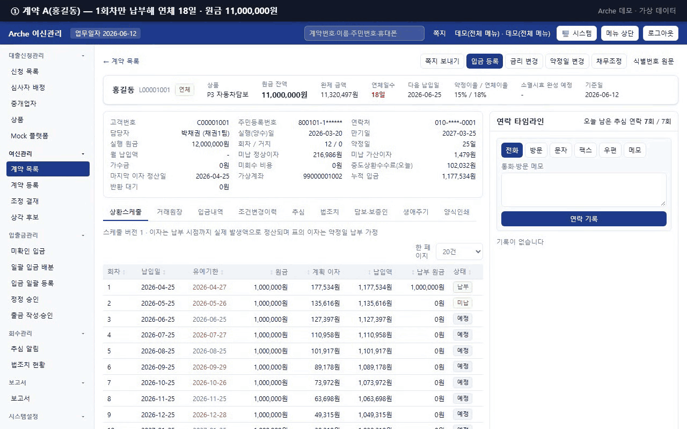
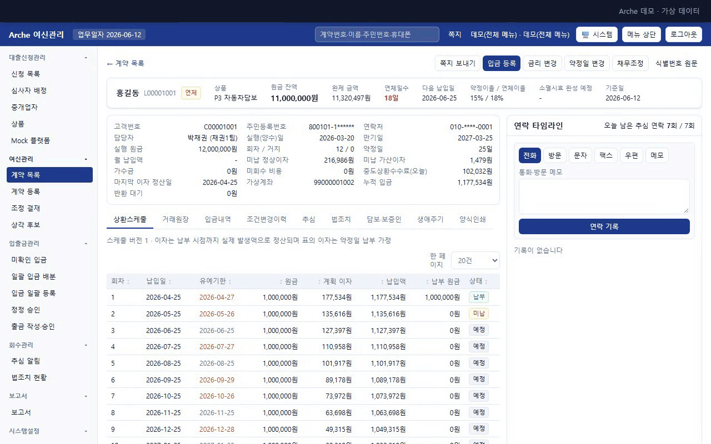
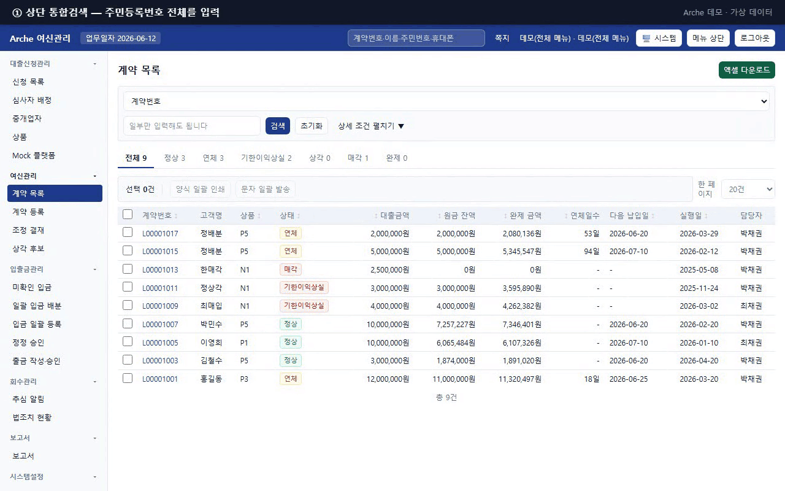

# Arche — 대부 여신관리 시스템

> 저축은행·대부업 여신 전산을 5년간 개발·운영하며 겪은 문제를 **Java 21 · Spring Boot 4 · Spring Modulith**로 다시 설계한 개인 프로젝트입니다.
> 가상의 대부업체 **예시대부(가상)** 를 두고, 계약 하나의 돈 흐름(이자·입금·취소·연체)을 실무 예외까지 정확하게 만드는 데 집중했습니다.

| 업무 모듈 | 테스트 메서드 | 계산 검증 사례 | 정책서 규칙 | 설계 결정 기록 |
| :---: | :---: | :---: | :---: | :---: |
| 17개 | 250개 | 28개 (G1~G28) | 75개 (R1~R75) | ADR 11개 |

통합 테스트(Testcontainers)는 GitHub Actions에서 실행합니다. R39 이후 규칙은 정책서에 없던 부분을 직접 정한 것이라 "가정·검수 필요"로 표시했습니다.

## 화면

**입금 매칭 → 삭제 → 정정 이동** (G11 → G27 → G28) — 과거 입금을 바꾸면 그날부터 이자·연체를 다시 계산합니다.



**추심 연락 7일 7회 한도** (G14) — 연락 기록은 남기되, 허용 여부는 매번 다시 판정합니다.



**주민등록번호·휴대폰번호 검색과 마스킹** — 원문은 암호화해 저장하고, 블라인드 인덱스로 일치 검색만 합니다.



> GIF는 업무일자를 2026-06-12에 고정해 녹화했습니다. 다시 녹화하는 방법은 [tools/demo-capture](tools/demo-capture/README.md)에 있습니다.

## 현업에서 겪은 문제 → Arche의 설계

| 실무에서 겪은 문제 | Arche에서 한 것 |
| --- | --- |
| 원 미만 절사 순서 때문에 중도상환수수료가 1원 어긋나고, 부동소수점 계산으로 금액이 한 단위 낮게 나옴 | 금액에 `double`·`float` 사용을 ArchUnit으로 금지. 절사 규칙(R2·R12)을 정책서에 고정하고 golden CSV 69행을 회차 단위로 대조 |
| 소급 입금·입금 취소·정정 때마다 원장을 손으로 다시 맞춤 | 계약 조건 + 이벤트 목록을 하루씩 재생하는 **순수 함수 엔진** 하나로 모으고, 달라진 거래만 역분개 + 새 거래로 기록. 원장 UPDATE·DELETE는 DB 트리거로 차단 ([ADR 0002](docs/adr/0002-replay-engine.md)) |
| 개인채무자보호법의 7일 7회 연락 제한·연락 유예 | 연락 기록은 저장하고 허용 판정은 입금 내역으로 매번 다시 계산. 자동 문자는 만들 때가 아니라 보내기 직전에 다시 판정 |
| 기한이익상실 통지가 재처리 때 바뀌어 버림 | "그때 보낸 통지"는 저장된 사실로 엔진에 다시 넣어 재생이 바꾸지 못하게 함 |
| 개인정보 분리보관·마스킹 요구 | 식별번호 필드 암호화(키 버전 관리) + 블라인드 인덱스 검색, 화면은 마스킹 값만, 원문 조회는 접근 기록 |
| 레거시에서 화면·모듈이 서로의 DB를 직접 조회 | Spring Modulith 모듈 경계와 "다른 모듈 Repository 참조 금지"를 테스트로 강제. 신청 → 계약은 이벤트 발행 기록(Outbox)으로 연결 |
| 서버 시계(`now()`)에 기대 계산해 재현이 안 됨 | 모든 계산은 업무일자 기준(R6), `LocalDate.now()` 사용을 테스트로 금지. 서버가 꺼졌던 날의 일마감은 기동 시 하루씩 따라잡음 |
| 같은 계약에 입금이 동시에 들어오는 문제 | 계약 단위 행 잠금(`SELECT … FOR UPDATE`, R31) |

## 구조

```mermaid
flowchart LR
  subgraph 접수
    O[origination<br/>신청·심사]
  end
  subgraph 계약·돈 흐름
    S[servicing<br/>계약·재생 엔진·원장]
    P[payment<br/>입금·매칭·정정]
    C[collection<br/>연체·추심·소멸시효]
  end
  subgraph 운영
    OP[operation<br/>일마감]
    R[reporting<br/>보고서·엑셀]
  end
  I[integration<br/>외부 기관 포트 + Mock]
  O == 대출 실행 이벤트(Outbox) ==> S
  P -- 재생 입력 --> S
  C -- 계약·소멸시효 조회 --> S
  C -- 입금 내역 --> P
  OP -- 일마감 --> S
  OP --> C
  OP --> P
  OP --> R
  R -- 잔액·원장 조회 --> S
  R --> P
  O -. 신용조회·본인인증 .-> I
  P -. 가상계좌 .-> I
  C -. 문자 .-> I
```

실선은 호출(의존) 방향, 굵은 선은 이벤트 발행 → 수신 방향입니다.

그 밖의 모듈: calendar(영업일), product, customer, staff(권한), note, document, communication, collateral, creditinfo, treasury.
외부 기관 연계(신용조회·신용정보 보고·본인인증·송금·문자·팩스·우편·담보 시세)는 모두 포트 + Mock 어댑터입니다.

## 만든 방식과 AI 활용

- **업무 규칙과 기대값을 먼저 고정:** 정책서(R1~R75)와 계산 검증 사례(G1~G28)를 먼저 정하고, 코드는 이 기대값을 맞추도록 작성했습니다.
- **AI 코딩 도구(Claude Code)로 구현:** 구현과 테스트 코드 작성에 AI를 적극적으로 썼습니다.
- **직접 한 것:** 실무 경험을 바탕으로 한 업무 규칙과 숫자 결정, 설계 방향(재생 엔진·모듈 경계·권한 행렬) 선택, golden 기대값 검수, ADR 승인, 정책서에 없는 규칙의 "가정" 판단.
- **검증 장치:** AI가 만든 코드도 golden 대조·모듈 경계·권한표 테스트를 통과해야 합치도록 CI를 구성했습니다.

## 문서

| 문서 | 내용 |
| --- | --- |
| [docs/policy.md](docs/policy.md) | 가상 회사 정책서: 모든 업무 규칙과 숫자 (R1~R75, R39 이후는 가정·검수 필요) |
| [docs/golden-cases.md](docs/golden-cases.md) | 계산 검증 사례 G1~G28: 테스트 기대값 |
| [docs/guide.md](docs/guide.md) | 구현 가이드: 설계 방향 |
| [docs/mvp.md](docs/mvp.md) | MVP 범위 |
| [docs/adr/](docs/adr/) | 설계 결정 기록 0001~0011 |

## 기술 스택 상세

- 백엔드: Java 21, Spring Boot 4.1.2, Spring Modulith 2.1.1, Hibernate 7(JPA), Flyway, PostgreSQL 18 (패키지 `dev.arche`)
- 락·세션·캐시: PostgreSQL 행 잠금(`FOR UPDATE`), 서블릿 세션, Caffeine, ShedLock JDBC
- 프런트엔드: Vite, React 19(React Compiler), TanStack Query, shadcn/ui, react-hook-form, zod 4, Vitest
- 통합 테스트(Testcontainers)는 GitHub Actions에서만 실행
- 문서(guide.md)와 다른 선택은 [ADR 0001](docs/adr/0001-tech-stack.md)

## 실행

```bash
# 1) 로컬 PostgreSQL 18에 DB와 사용자 생성 (기본값: arche / arche / arche)
createdb arche
# 2) 백엔드 — 기동 시 Flyway가 스키마·상품·휴일을 만들고, 데모 직원·계약을 넣는다
cd backend && ./gradlew bootRun           # http://localhost:8080
# 3) 프런트엔드 — /api는 8080으로 프록시
cd frontend && npm ci && npm run dev      # http://localhost:5173
```

포트가 다른 프로젝트와 겹치면 바꿔서 띄웁니다.

```bash
cd backend && ./gradlew bootRun --args='--server.port=8081'
cd frontend && ARCHE_WEB_PORT=5174 ARCHE_API_URL=http://localhost:8081 npm run dev   # http://localhost:5174
```

접속 정보는 환경변수 `DB_URL`, `DB_USERNAME`, `DB_PASSWORD`로 바꿉니다. 운영에서는 `ARCHE_DEMO=false`와 암호화 키
(`ARCHE_FIELD_KEY_V1`, `ARCHE_INDEX_KEY`, Base64 32바이트), `ARCHE_VA_SECRET`, `ARCHE_ADMIN_PASSWORD`를 반드시 넣습니다.

### 데모

모든 계산의 기준일은 업무일자입니다(R6). 업무일자는 매일 23:00 일마감이 다음 날로 넘기고, 서버가 꺼져 있어 마감이 빠졌으면
**기동할 때 밀린 일마감을 하루씩 처리해 오늘로 맞춥니다**(연체·상실·알림 판정을 건너뛰지 않음). 데모 데이터는 2026-06-12 기준으로
만들어지므로 첫 기동 때 오늘까지 따라잡습니다. golden 사례 G11·G27·G28을 문서 값 그대로 화면에서 재현하려면 `ARCHE_CATCH_UP=false`로
2026-06-12에 고정한 뒤, 시스템관리자의 일마감으로 하루씩 넘기세요.
데모 직원은 모두 비밀번호 `arche1234!`입니다.

| 아이디 | 역할 | 아이디 | 역할 |
| --- | --- | --- | --- |
| `uw` | 심사역 | `collead` | 채권팀장 (2팀) |
| `uwlead` | 심사팀장 | `teller` | 출납 |
| `col1` | 채권담당 (2팀) | `head` | 본부장 |
| `col2` | 채권담당 (3팀) | `admin` | 시스템관리자 |
| `demo` | **데모 전용: 모든 메뉴** | | |

`demo`는 정책서 역할이 아닌 데모 전용 계정입니다(`DEMO_ALL`). 데모 모드에서만 만들어지고, 데모 모드를 끄면 로그인할 수 없습니다. 작성자 ≠ 승인자 검사는 그대로라 `demo`가 요청한 마감 후 정정은 다른 계정(`collead`)이 승인해야 합니다.

| 계약 | 내용 | 화면에서 해 볼 것 |
| --- | --- | --- |
| A 홍길동 (P3, G2 조건) | 1회차만 납부 → 연체 18일 | 미확인 입금(05-26, 1,135,616원)을 A에 매칭 → 정상 (**G11**). 그 입금을 삭제 → 연체 부활 (**G27**). 연체 상태에서 채무조정 견적 → 미감면 이자 입금 → 체결 (**G23**) |
| B 김철수 (P5) | 잔액 3,000,000원 | A의 입금을 B로 정정 이동 → 이자 9,616원, 원금 1,126,000원 충당 (**G28**) |
| C 이영희 (P1, G1 조건) | 5회차까지 정상 | 금리 인하(G24), 약정일 변경(G25), 일부 중도상환(G20) |
| D 박민수 (P5, G15 조건) | 자유상환 | 수시 상환, 금액 오입력 당일 정정(G26) |
| E 최매입 (N1, G17 조건) | 매입채권 | 충당 순서, 누적 회수율. 추심 탭에서 분할납부 약속 등록·판정(**G19**), 소멸시효 확인(**G13**) |

상단 바의 **통합 검색**창에 계약번호·이름·주민등록번호·휴대폰번호를 넣으면 조회 범위 안의 계약을 찾습니다(결과가 하나면 바로 상세로 이동). 주민등록번호·휴대폰번호는 블라인드 인덱스로 일치 검색하고 결과에는 마스킹된 값만 보입니다.

계약 상세의 **추심** 탭에서 연락 유예를 등록하거나 연락을 기록하면 직전 7일 7회 한도·연락 가능 시간·소멸시효 완성 여부로 허용·차단을 판정합니다(**G14**). 소멸시효 임박·약속 불이행 알림은 일마감 때 만들어져 **추심 알림** 화면에 나옵니다.

## 테스트

```bash
cd backend && ./gradlew test               # 단위: golden G1~G28, 모듈 경계, 권한표 (Docker 불필요)
cd backend && ./gradlew integrationTest    # 통합: Testcontainers (CI)
cd frontend && npm test
```

- `GoldenScheduleTest`: [golden/schedules.csv](backend/src/test/resources/golden/schedules.csv) 69행(G1~G4, G20, G23, G24, G25)을 회차 단위로 대조
- `GoldenScenarioTest`·`PolicyRuleTest`: G5~G28, R3·R5·R9·R23·R29·R32·R33 등 정책 분기, 재생 결정성
- `ArchitectureTest`: Spring Modulith 모듈 경계, 다른 모듈 Repository 참조 금지, `LocalDate.now()` 금지, double/float 금지, 엔진의 Spring·JPA 비의존
- `SecurityIT`·`PaymentCorrectionIT`·`WorkoutIT`·`CollectionIT`·`DeferralMessageIT`·`IntegrationFlowsIT`: 연락 유예·자동 문자, G13·G14·G19 저장·판정, 채무조정 결재권·체결 거절(R23), 권한표 허용·차단, G11→G27→G28 REST 흐름, 웹훅 중복 통지, 1,000행 일괄 등록, 신청→계약 이관, 원장 UPDATE·DELETE 차단

## 진행 기록 — 무엇을 왜 이렇게 만들었나

1. **계산 엔진을 이벤트 재생 방식으로** ([ADR 0002](docs/adr/0002-replay-engine.md)) — 소급 입금·입금 취소·정정 이동·금리 변경이 모두
   "과거 어느 날부터 다시 계산"이라서, 계약 조건과 이벤트 목록을 받아 하루씩 재생하는 순수 함수 하나로 모았다. 취소는 이벤트를 비활성으로
   바꾸고 다시 재생하는 것이고, 저장 계층은 재생 결과와 저장된 원장을 비교해 달라진 거래만 역분개 + 새 거래로 남긴다. 원장은 DB 트리거로
   UPDATE·DELETE를 막았다.
2. **이자 구간은 하루 단위 기준이 바뀌는 곳에서만 자른다** — 정상이자(원금 × 약정이율)와 가산이자(미납 원금 또는 상실 후 전체 잔액 × 가산분)를
   각각 "기준금액·이율이 같은 연속된 날"로 묶어 구간마다 절사한다(R2·R12). 미납된 약정일이 구간 경계가 되지 않는 것이 자연스럽게 나온다.
3. **기한이익상실 통지는 저장된 사실로 다시 넣는다** — 재생은 결정적이지만 통지는 "그때 보낸 것"이라 재생이 바꾸면 안 된다. 저장된 통지를
   엔진 입력으로 넣고, 재생 결과 사유가 없어지면 REVOKED(R5), 과거에 생겼어야 할 새 사유는 처리일로 미룬다(R29).
4. **모듈 경계** — servicing은 payment의 입금 테이블을 읽지 않고 자기 `account_event`에 재생 입력을 보관한다. 신청→계약은 Modulith 이벤트
   발행 기록(Outbox)으로 잇는다. 경계는 `ApplicationModules.verify()`와 ArchUnit이 검사한다.
5. **채무조정도 재생 이벤트로** (G23) — 체결일까지 이자를 확정해 감면하고, 그날 받은 입금으로 미감면 이자가 다 채워지면 조정 원금으로
   원리금균등 스케줄을 새로 만든다. 못 채우면 체결하지 않고(R23) API가 트랜잭션째 되돌린다. 조정 후 3회차 연속 미납이면 감면액을
   ADJUSTMENT 거래로 되살리고 기한이익상실로 복귀한다(R9). 감면 항목별 결재권(연체이자 담당자, 정상이자 팀장, 원금 본부장)은 API에서 검사한다.
6. **추심은 기록은 저장하고 판정은 다시 계산** (G13·G14·G19) — 연락 기록은 차단된 시도까지 남기되 한도에는 허용·예약된 연락만 센다.
   분할납부 약속 판정과 소멸시효 완성일은 저장하지 않고 입금 내역(취소 반영)으로 매번 다시 계산해, 소급 입금·입금 취소가 있어도
   결과가 어긋나지 않게 했다. 저장하는 것은 약속 해제·알림처럼 "그때 한 일"뿐이며 일마감에서 확정한다.
7. **자동 문자는 만들 때가 아니라 보낼 때 판정** — 일마감이 다음 날 08:00 발송분(약정일 3일 전 납입 안내, 연체 1·7·30일째,
   완제 안내)을 만들어 두고, 발송기가 연락 가능 시간 안에서 발송 직전에 7일 7회·연락 유예·소멸시효·약속 이행 여부를 다시 본다.
   밤사이 입금으로 연체가 풀리면 연체 문자는 건너뛴다. 실제 발송은 `MessagingPort` Mock 어댑터가 로그만 남긴다.
8. **권한표를 코드 행렬로** ([ADR 0004](docs/adr/0004-security.md)) — 정책서 9.1 표를 `Permission` enum으로 옮기고, 표 자체를 테스트 데이터로 대조한다.

## mvp.md 5장 기능 (가정·검수 필요)

2026-11-01에 mvp.md 5장 "범위 밖 기능"도 모두 구현했습니다. 정책서에 없던 업무 규칙은 직접 정해 정책서 9장에
"(가정·검수 필요)"를 붙여 적었고, 묶음마다 ADR에 설계 이유를 남겼습니다. 다섯 묶음을 병렬로 만들어 `feature/*` 브랜치로 합쳤습니다.

| 기능 | 화면 | 규칙 | 설계 |
| --- | --- | --- | --- |
| 상각 확정, 매각·환매, 매각 후 입금 이전 | 계약 상세 "생애주기" 탭, 메뉴 "상각 후보" | R39~R41 | [ADR 0005](docs/adr/) |
| 수기 조정, 상계, 완제·매각·상각 후 취소 | 메뉴 "조정 결재", 생애주기 탭 | R42~R44 | ADR 0005 |
| 사망·개인회생·파산·공적 채무조정(가상) 추심 중지 | 추심 탭 "추심 중지" 카드 | R45·R46 | ADR 0005 |
| 한 고객 여러 계약 일괄 배분, 보증인·제3자 대위변제 | 메뉴 "일괄 입금 배분", 입금 등록 대화상자 | R47~R50 | ADR 0006 |
| 법조치(지급명령·압류·경매), 배당금·공탁금 입금 | 계약 상세 "법조치" 탭, 메뉴 "법조치 현황" | R51·R52 | ADR 0006 |
| 서류 징구, 자동 거절, 심사자 배정, 중개수수료 정산·환수 | 메뉴 "신청 목록"·"심사자 배정"·"중개업자"·"상품" | R53~R56 | ADR 0007 |
| 비교 플랫폼 접수, 신용조회, 본인인증 랜딩 | 메뉴 "Mock 플랫폼", `/landing/:token` | R57·R58 | ADR 0007 |
| 문자·팩스·우편, 연락 타임라인, 문자 템플릿 | 계약 상세 오른쪽 패널, 메뉴 "문자 템플릿" | R59 | ADR 0008 |
| 담보·보증인, 담보 시세 연계 | 계약 상세 "담보·보증인" 탭 | R60 | ADR 0008 |
| 신용정보 보고 파일, 송금(출금 작성·승인) | 메뉴 "신용정보 보고"·"출금 작성·승인" | R61~R64 | ADR 0008 |
| 일보, 연체 전이율, 대손충당금, 회계 분개, 엑셀 다운로드 | 메뉴 "보고서", 계약 목록 엑셀 버튼 | R65~R68 | ADR 0009 |

외부 기관 연계(신용조회·신용정보 보고·본인인증·송금·팩스·우편·담보 시세·비교 플랫폼)는 모두 포트 + Mock 어댑터이며, 파일 형식은 자체 설계입니다.

데모 데이터 추가분: 상각 후보 L00001015, 매각 계약 L00001017, 일괄 배분용 고객 C00001009(계약 L00001011·L00001013, 미확인 입금 1건,
지급명령 1건), 심사 신청·중개업자 B00001001.

## 확장 지점 (아직 만들지 않은 것)

| 기능 | 확장 지점 |
| --- | --- |
| 연계 재시도·서킷브레이커(Resilience4j), 연계 로그 통합(`integration_call_log`로 일원화) | integration 모듈 |
| 우편 도달일 → 기한이익상실 통지 도달일(R15) 연결, 입금 취소 후 신용정보 보고 정정 | communication·creditinfo |
| 양수인에게 매각 후 입금 실제 지급, 중개수수료 실제 지급 | treasury 출금 유형 추가 |
| 대량 다운로드 관리자 알림 (guide 8.2) | reporting 엑셀 + 접근 기록 |
| 상각 후보 월말 배치 (지금은 후보 목록 화면) | operation 일마감 |
| 매입채권 채무조정·조정 완제, 매입채권 연체 문자(R38로 현재는 보내지 않음, 기준일 정의 필요) | collection |
| 계약 목록 일괄 문자 발송, 담당자·속성 일괄 변경 | `frontend/src/features/loans/bulk/bulkActions.ts`에 작업 등록 + 작업별 서버 API ([ADR 0010](docs/adr/0010-print-documents-and-bulk-actions.md)) |
| 양식 관리 화면(양식 추가·수정, 치환 문자열 검증은 이미 있음), PDF 저장 | document 모듈 `print_template` + `DocumentPlaceholders.validate` |
| 대량 일마감 성능 | 마지막 마감 스냅샷부터 재생 |
